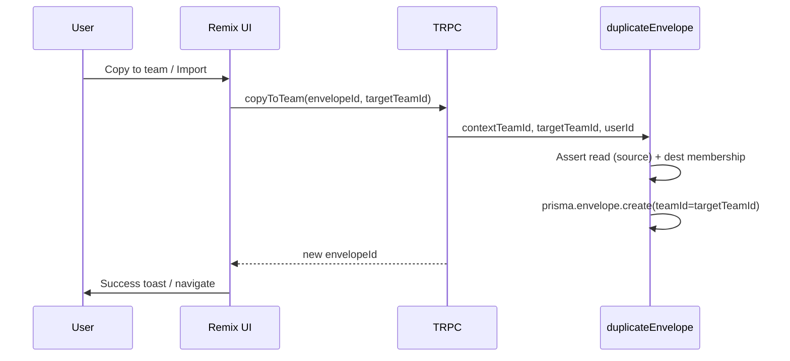

# Template copy across teams (forward + import)

## Context

Multi-team Documenso organisations need to reuse template structure (PDFs, recipients, fields, editor contents) on another team the same user can access. **Duplicate** today always writes to the active team context. This design adds **copy to another team** in two product phases: row-level **Copy to team…** (forward), then page-level **Import from team…** (import). Both are **copy** operations; the source template is unchanged.

**Users:** Any organisation member with read access to the source template and membership on the destination team (same organisation).

**Prerequisite:** [`../exploration/template-copy-cross-team.md`](../exploration/template-copy-cross-team.md)

## Related Docs

- [`../exploration/template-copy-cross-team.md`](../exploration/template-copy-cross-team.md) — codebase scan and gaps
- User docs (post-ship): `apps/docs/content/docs/users/templates/` — optional how-to for org admins

## Decision

### Chosen approach: one server primitive, two UIs

1. Extend `duplicateEnvelope` (or a thin wrapper `copyTemplateToTeam`) with **`contextTeamId`** (TRPC `ctx.teamId`, used for auth/read) and **`targetTeamId`** (where the new envelope is created).
2. **Phase 1 — Forward:** New dropdown action on team-owned templates → dialog with destination team `Select` → mutation → toast + optional navigate to new template on **destination** team (switch team URL in path).
3. **Phase 2 — Import:** Button on team templates index → wizard: source team → template list → confirm → same mutation with `targetTeamId = ctx.teamId`.
4. Reuse existing duplicate defaults: include recipients, fields, and contents; no direct link; `templateType` coercion per existing logic in `duplicate-envelope.ts`.

### Product rules

| Topic | Rule |
|-------|------|
| **Semantics** | Always **copy**, never delete or move source. UI copy: “Creates a copy on the selected team.” |
| **Organisation** | `targetTeam.organisationId` must equal `contextTeam.organisationId`. Reject cross-org with `UNAUTHORIZED` / `NOT_FOUND`. |
| **Destination membership** | Caller must pass `getTeamById({ teamId: targetTeamId, userId })`. |
| **Source read — Phase 1** | Template owned by `contextTeamId` and readable via existing `getEnvelopeWhereInput` (same as Duplicate today). |
| **Source read — Phase 2** | If team-scoped read fails, allow **organisation templates** via same rules as `getOrganisationTemplateById`. Optional: list source team’s **team** templates when user is a member of `sourceTeamId` (TRPC calls with source team header or dedicated query). |
| **Write permission** | Destination: user must be a team member with visibility sufficient to create templates (same bar as `envelope.duplicate` on that team—no new role matrix in v1). |
| **Same-team copy** | **Duplicate** remains the in-team action. **Copy to team** hides or disables when `targetTeamId === contextTeamId` and source `teamId === contextTeamId`. |
| **Org tab (Phase 1)** | v1 forward from **team** tab only (`canMutate`). Org-view forward deferred to Phase 2 or a small follow-up using org read path. |
| **templateType** | Keep `duplicateEnvelope` behavior: `ORGANISATION` source copied to another team becomes `PRIVATE` on destination. |
| **Title** | Keep ` (copy)` suffix (existing). |
| **Direct link** | Not copied (unchanged). |
| **Folder** | New template at team root (`folderId` null) in v1. |
| **Rate limits** | No new document quota (templates only). If later extended to documents, use existing `assertOrganisationRatesAndLimits`. |
| **Billing** | No Stripe seat change (template create only). |
| **API naming** | Prefer dedicated route `envelope.copyToTeam` (or `template.copyToTeam`) over overloading `duplicate` OpenAPI contract; internally call shared lib. |

### Rejected alternatives

| Alternative | Why rejected |
|-------------|--------------|
| **Move template between teams** | Higher risk (breaks links, audit, direct links); users asked for share/reuse, not relocation. |
| **Organisation-wide shared template pointer** | Org templates already exist; this feature is about **material copy** onto another team’s workspace. |
| **Separate “import” server implementation** | Duplicates auth and Prisma logic; one lib function with `targetTeamId` is sufficient. |
| **Email / link “forward”** | Different product (share URL); not template duplication. |
| **Cross-org template marketplace** | Large scope; explicit v1 same-org boundary. |
| **Always use `getEnvelopeWhereInput` only** | Fails for org templates visible on another team’s list; need `getOrganisationTemplateById` rules for Phase 2. |

## Phases

### Phase 1 — Forward (“Copy to team…”)

**Goal:** From a team-owned template row, copy to another eligible team.

| Workstream | Files (indicative) |
|------------|-------------------|
| Lib | `packages/lib/server-only/envelope/duplicate-envelope.ts` — split read `contextTeamId` vs write `targetTeamId`; validate org + membership |
| Lib (helper) | `packages/lib/server-only/template/assert-template-copy-access.ts` (new) — centralize source read attempts |
| TRPC | `packages/trpc/server/envelope-router/copy-to-team.ts` + `.types.ts`; register on `envelope-router/router.ts` |
| UI | `apps/remix/app/components/dialogs/template-copy-to-team-dialog.tsx` (new) |
| UI | `templates-table-action-dropdown.tsx` — menu item under `canMutate` |
| i18n | Lingui strings in dialog |
| Tests | `packages/app-tests/e2e/templates/template-copy-to-team.spec.ts` |

**Done when:**

- User on Team A copies template to Team B; template appears in B’s list; A unchanged.
- User cannot target a team outside org or a team they are not on.
- Same-team destination not offered in forward dialog.
- Green typecheck + E2E on two teams in one org.

### Phase 2 — Import (“Import from team…”)

**Goal:** On current team B, browse accessible templates from team A (or org catalogue) and import into B.

| Workstream | Files (indicative) |
|------------|-------------------|
| TRPC | `template.findImportableTemplates` (query): `sourceTeamId`, pagination — team templates via membership + org templates via `findOrganisationTemplates` filter |
| UI | `templates._index.tsx` — primary/secondary CTA + multi-step dialog |
| Lib | Extend `assert-template-copy-access` for org + cross-team team templates |
| Tests | E2E import path; extend `organisation-templates.spec.ts` patterns |

**Done when:**

- From Team B, user selects Team A, picks template, copy lands on B without visiting A’s UI.
- Reuses Phase 1 mutation only (no second write path).

## Data model

**No schema migration.** New templates are normal `Envelope` rows with new ids, same as duplicate.

Optional future: audit log event `TEMPLATE_COPIED_TO_TEAM` with `{ sourceEnvelopeId, sourceTeamId, targetTeamId }` — not required for v1.

## API shape

Documenso pattern: route file + co-located Zod types + OpenAPI meta (GET/POST only).

### `envelope.copyToTeam` (mutation)

**Input (`ZCopyTemplateToTeamRequestSchema`):**

| Field | Type | Notes |
|-------|------|--------|
| `envelopeId` | `string` | Source template envelope id |
| `targetTeamId` | `number` | Destination team |
| `includeRecipients` | `boolean` optional, default `true` | Same semantics as duplicate |
| `includeFields` | `boolean` optional, default `true` | Requires recipients |
| `includeContents` | `boolean` optional, default `true` | |

**Output:** `{ id: string }` — new envelope id on destination team.

**Context:** `contextTeamId` from authenticated team header (`ctx.teamId`), not from body.

**Errors:** `AppError` — `NOT_FOUND` (unreadable source), `UNAUTHORIZED` (dest team / org), `INVALID_REQUEST` (not a template).

### Phase 2 — `template.findImportableTemplates` (query)

**Input:** `sourceTeamId`, `page`, `perPage`, optional `query`.

**Output:** Same lite shape as `findTemplatesInternal` / org list (envelopeId, title, teamId, …).

## UI/UX

### Phase 1 — Copy to team dialog

- **Trigger:** Action menu → **Copy to team…** (icon: `Share2` or `Forward` — avoid collision with Direct link).
- **Content:** Short description + `Select` of teams (`currentOrganisation.teams` filtered: `id !== contextTeamId` and user is member — session list already scoped).
- **Empty state:** “No other teams in this organisation.” — disable submit.
- **Loading:** Dialog fieldset `:disabled` while pending (match `TeamDeleteDialog` / `EnvelopeDuplicateDialog`).
- **Success:** Toast “Template copied to {teamName}.” Navigate to `/t/{destTeamUrl}/templates/{id}/edit` or stay on list and invalidate queries (prefer navigate for clarity, mirror duplicate).
- **Error:** Destructive toast; generic message (parse `AppError` code if wired).

### Phase 2 — Import wizard

- **Entry:** Team templates page toolbar (not org view) — **Import from team…**
- **Steps:** (1) Source team select (2) Searchable template table (3) Confirm copy
- **Progress:** Stripe-style stepped dialog; back navigation preserved.

### Quality bar

- Progressive disclosure: Phase 1 is a single dialog, no wizard.
- Confirm non-destructive but make destination team obvious before submit (selected team name in primary button: “Copy to {name}”).

## Permissions

| Check | Mechanism |
|-------|-----------|
| Authenticated user | `authenticatedProcedure` |
| Context team | Existing team header validation |
| Source read | `getEnvelopeWhereInput` and/or `getOrganisationTemplateById` rules |
| Dest write | `getTeamById` on `targetTeamId`; same org via `callerTeam.organisationId` |
| Team role visibility | `TEAM_DOCUMENT_VISIBILITY_MAP` + `getMemberRoles` on **context** team for org templates |

No new organisation role flags in v1. Team **ADMIN** / **MANAGER** / **MEMBER** behavior unchanged from duplicate.

## Observability

- TRPC: `ctx.logger.info({ input: { envelopeId, targetTeamId } })` on mutation (match `duplicate-envelope` route).
- No webhooks for template duplicate today — do not add v1.
- Optional structured metric later: `template.copy_to_team` count by org.

## Open Questions

- [ ] **Menu label: “Copy to team” vs “Forward to team”?**
  - **AI suggestion:** Use **Copy to team…** as primary label with description “Creates a copy on the selected team.” **(Recommended)** — “Forward” implies email or move; aligns with Duplicate wording.

- [ ] **Phase 1: allow forward from organisation template view for read-only rows?**
  - **AI suggestion:** Defer to Phase 2 import + small dropdown follow-up using `getOrganisationTemplateById`. Ship Phase 1 on team tab only to reduce auth surface. **(Recommended)**

- [ ] **After copy, navigate to destination team editor or stay on source list?**
  - **AI suggestion:** Navigate to destination team template editor (same as Duplicate navigates to current team). **(Recommended)** — user sees immediate result; invalidate `template.findTemplatesInternal` for both teams if user navigates back.

- [ ] **Expose `copyToTeam` on public OpenAPI / embed API?**
  - **AI suggestion:** TRPC + OpenAPI meta for parity with `envelope.duplicate`; no embed iframe changes v1. **(Recommended)** unless API-only customers need it in Phase 1.

## Next step

Run `/plan` with Phase 1 tasks; treat all **(Recommended)** open questions as plan defaults unless product objects before implementation.